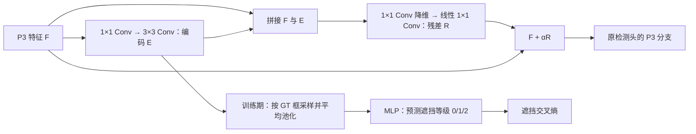

# VisDrone 遮挡编码与 P3 检测特征融合

该模式将每个目标的遮挡等级 `0/1/2` 用于训练一个紧凑的编码分支，并把编码送入实际检测路径。它借鉴“遮挡编码参与下游特征融合”的思想，是面向 VisDrone 的适配设计，尚未证明能提高检测效果。旧 `--occlusion-supervision` 和 `--weighted` 模式仍保留；新模式使用 `--occlusion-fusion`，不使用 GOA。

## 结构和监督



`E = Encoder(F)`，`R = φ(concat(F, E))`，`F_new = F + αR`。仅替换送给 Detect 的 P3 特征，P4/P5 保留原输入。编码默认 32 通道；残差投影先降到编码宽度，再映射回 P3 通道。可学习的标量 α 从 `0.01` 开始，保留原特征的直接路径；该初值不保证训练一定稳定或有效。

检测损失训练检测头、融合投影和编码分支；遮挡损失监督 GT 区域中的编码 E，进一步训练编码分支及其上游共享特征。总损失为：

```text
L_total = L_detection + aux_weight × progress(epoch) × mean(CE_occlusion)
```

普通检测 BCE、CIoU、DFL 和 TAL 分配保持原实现。每个有效遮挡 GT 都参与 ROI 遮挡监督，不依赖 TAL 是否给它分配了正样本。未知或冲突的 `occ_valid: false` 记录跳过遮挡 CE，仍保留检测框与类别。

ROI 使用归一化 GT 框内 `3×3` 网格的双线性采样与平均池化，属于区域弱监督，不是可见区域掩码。不会将遮挡等级当成背景类别，也不会把整个 GT 框写成逐像素遮挡标签。密集目标的区域可能包含邻近目标，等级标签不能提供真实可见像素的位置。

训练默认前 5 轮辅助贡献为零，随后 10 轮逐步增大；**编码和融合从第 1 轮就由检测损失训练**。推理保留编码与融合模块，删除的是 GT 区域采样和辅助分类计算。图片即可推理，无需 GT 或 JSON；编码与融合会增加参数及计算量。

## 更新旧 ZIP

将交付固定提交中的 `update_occlusion_supervision.py` 下载到外层解压目录或项目根目录，然后运行：

```powershell
python update_occlusion_supervision.py --root . --ref <交付的完整40位提交SHA>
```

更新器校验所有文件的 SHA256 和 Python 语法，备份后替换代码；失败时恢复已替换的文件。它不会启动训练，不修改数据、你的数据 YAML 或已有 `runs`。支持你当前 `cc2d8ee9` ZIP 的一层外目录结构。下载与更新的一行命令在交付回复中提供，更新成功打印 `UPDATE_APPLIED` 和 `ROOT`。

## 从头训练

在 `ROOT` 指向的项目目录使用 `cuda129` 环境，数据继续使用 `images/train,val`、五列 `labels/train,val` 和对应 `occlusion/train,val/*.json`。你的 YAML 路径保持 `ultralytics/cfg/datasets/visdrone2019-occ.yaml`。

```powershell
python examples/VisDrone-Occlusion/train_visdrone.py --occlusion-fusion --model yolo11n.yaml --data ultralytics/cfg/datasets/visdrone2019-occ.yaml --epochs 200 --imgsz 640 --batch 4 --device 0 --workers 0 --aux-weight 0.1 --aux-warmup 5 --aux-ramp 10 --encoding-channels 32 --fusion-init 0.01 --amp --seed 42 --optimizer AdamW --lr0 0.001 --patience 0 --name occ_fusion_scratch_200
```

不指定 `--pretrained`，从随机初始化训练。融合模块由 Python 模型构造器接入，继续使用普通 `yolo11n.yaml`，无需另建模型 YAML。默认 `deterministic=False`，使用同样的 letterbox、HSV、翻转增强。不能与 `--occlusion-supervision` 或 `--weighted` 同时启用。

## 分清三个对照

| 组别 | 参数 | 作用 |
| --- | --- | --- |
| 普通检测对照 | `--occlusion-supervision --aux-weight 0` | 原检测路径，辅助分支不参与前向检测和监督 |
| 只有新模块 | `--occlusion-fusion --aux-weight 0` | 编码与融合由检测损失训练，无遮挡 CE |
| 新模块加遮挡监督 | `--occlusion-fusion --aux-weight 0.1` | 编码参与检测并接受遮挡等级监督 |

普通检测对照采用同一元数据读取器和增强，以减少入口差异：

```powershell
python examples/VisDrone-Occlusion/train_visdrone.py --occlusion-supervision --model yolo11n.yaml --data ultralytics/cfg/datasets/visdrone2019-occ.yaml --epochs 200 --imgsz 640 --batch 4 --device 0 --workers 0 --aux-weight 0 --amp --seed 42 --optimizer AdamW --lr0 0.001 --patience 0 --name occ_fusion_plain_baseline_200
```

只有新模块的对照：

```powershell
python examples/VisDrone-Occlusion/train_visdrone.py --occlusion-fusion --model yolo11n.yaml --data ultralytics/cfg/datasets/visdrone2019-occ.yaml --epochs 200 --imgsz 640 --batch 4 --device 0 --workers 0 --aux-weight 0 --encoding-channels 32 --fusion-init 0.01 --amp --seed 42 --optimizer AdamW --lr0 0.001 --patience 0 --name occ_fusion_no_aux_200
```

以上三组保持分辨率、增强、种子、初始化来源、优化器和轮数相同。`--aux-weight 0` 在融合模式中不关闭融合；`--fusion-init 0` 也不是关闭模块，因为 α 可学习。独立入口 `train_occlusion_supervised.py` 同样支持 `--occlusion-fusion`。

## 检查实际启用情况

启动日志会说明 `P3 occlusion encoding + residual fusion`。输出位于实际的 `runs/<name>/`，同名目录存在时会追加编号。

- `occlusion_supervision_config.json`：`feature_fusion: true`、编码宽度、损失系数和推理路径信息。
- `occlusion_supervision_diagnostics.jsonl`：每轮遮挡等级数量、有效/未知 GT、原始 CE、各等级训练准确率、进度和 `fusion_scale`。
- `results.csv`、`weights/best.pt`、`weights/last.pt`：普通检测指标和完整模型。

验证不计算 GT 区域辅助分类，`val/occ_loss=0` 是预期行为，验证检测仍经过编码与融合。辅助 CE 降低、α 变化只能说明分支在学习，不能证明召回提升。最终需比较整体 mAP、重度遮挡召回、小目标召回、误检与推理耗时。

加载完整 checkpoint 需要使用包含本方案自定义类的仓库。预测可在项目根目录运行：

```powershell
python -c "from ultralytics import YOLO; YOLO('runs/occ_fusion_scratch_200/weights/best.pt').predict(source='C:/date/VisDrone_occ/images/val', imgsz=640, device=0, conf=0.25, max_det=1000)"
```

本次只执行静态代码审查、语法与纯标准库的 CLI/更新器检查，没有运行模型、训练、验证或 pytest。模型导出、断点恢复和实际检测效果仍需要在你的环境中验证。
