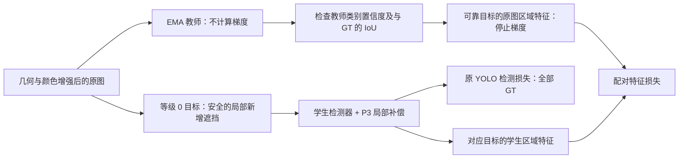

# VisDrone：遮挡等级引导的配对训练与局部特征补偿

这是独立的新实验入口 `train_occlusion_paired.py`，不是此前的遮挡等级分类损失或 P3 遮挡编码融合。它使用真实等级 `0/1/2` 选择训练配对，通过原图与新增遮挡图之间的特征约束训练检测器。完整方案还包含 P3 的局部特征补偿模块。该方案属于适配 VisDrone 的研究假设，尚未证明优于基线，也不是对某篇论文的完整复现。

## 数据要求

保留现有目录，不重命名或合并 `labels` 与 `occlusion`：

```text
C:/date/VisDrone_occ/
├── images/
│   ├── train/
│   └── val/
├── labels/
│   ├── train/       # 每行 class cx cy width height，共五列
│   └── val/
└── occlusion/
    ├── train/      # 与图片同名的 JSON
    └── val/
```

继续使用已有的 `ultralytics/cfg/datasets/visdrone2019-occ.yaml`。新 ZIP 内另外提供 `examples/VisDrone-Occlusion/visdrone_occ.yaml` 模板，其 `path` 默认是 `C:/date/VisDrone_occ`。这两个文件选一个传给 `--data` 即可。不要使用带自动下载及重新转换钩子的普通 VisDrone YAML，以免丢失已有的元数据安排。

真实遮挡等级不会被改写。等级 1、2 的目标正常参与检测损失；未知或冲突等级的目标也保留检测框与类别。合成遮挡覆盖率属于新增训练条件，不能当成新的真实等级标签，也不是可见区域掩码。

## 完整方案如何工作



1. **可靠的原图参考。** 先完成保持元数据对应关系的 letterbox、HSV 与翻转。EMA 教师只看原图，学生看后续构造的新增遮挡图。前 10 轮先进行普通检测训练；之后启用配对流程，并在 10 轮内逐步引入配对损失。教师来自同一次训练的 EMA，没有额外加载外部预训练模型。只有教师在原图上给出的对应类别置信度不低于 `0.15`、预测框与该 GT 的 IoU 不低于 `0.5`，该目标才允许构造配对。
2. **训练期新增遮挡。** 配对概率随预热后的进度增加，最终每张图片以 `0.5` 的概率尝试构造配对，只选择遮挡等级明确为 0 且具有可靠教师参考的目标。新增遮挡面积占目标框的 `15%～35%`。遮挡区域必须检查所有邻近 GT；任何邻近目标被新增遮挡的比例超过 `35%`，该候选都不能采用。等级 2 的邻近目标不允许被新增遮挡。过小而无法满足像素及覆盖率限制的框会跳过配对，仍保留检测监督。
3. **具体的特征学习目标。** 在同一个 GT 区域以 `3×3` 网格采样教师原始 neck P3 和学生送往检测分支的 P3 特征，计算通道方向的余弦距离。配对计算使用 FP32；教师参考停止梯度，配对损失训练学生及其上游特征。普通检测 BCE、CIoU、DFL 和 TAL 继续采用原实现。没有可靠教师参考时，该目标仍参与普通检测训练。
4. **P3 局部补偿。** 将 backbone P2 细节平均池化到 P3 尺度并投影，P3 经紧凑的深度卷积与扩张卷积提取局部上下文，neck P4 上采样并投影。融合特征经过空间 sigmoid 门控与最后的残差投影，补回实际检测路径中的 P3。最终残差投影使用零初始化，使新模块的初始输出保留原 P3。检测损失与配对约束共同训练该模块；模块在推理时也存在，会增加参数及计算量。教师、新增遮挡和 GT 区域配对只用于训练，预测时只输入图像。

原图参考不是“完整目标真值”：原图中可能已有遮挡，等级 0 也不能提供真实的完整掩码。配对训练直接约束的是新增遮挡导致的特征变化，对真实重度遮挡目标的帮助需要实验验证。本实现不修改 NMS，也没有通过这条特征损失改变 TAL 正样本分配。

总损失形式是：

```text
L_total = L_YOLO + pair_weight × progress(epoch) × L_paired_feature
```

默认 `pair_weight=0.05`。不能仅凭总损失下降或配对损失下降判断检测改善。

## 在 Windows 上运行

将完整 ZIP 解压，进入包含 `pyproject.toml`、`ultralytics/` 和 `examples/` 的项目根目录。激活你现有的 `cuda129` 环境，然后安装当前目录，避免导入旧仓库的代码：

```powershell
conda activate cuda129
```

```powershell
python -m pip install -e . --no-deps
```

先运行随包提供的 CPU 检查，再启动长训练。这条命令会在你的本地执行少量合成数据前向和反向，不读取 VisDrone，也不加载预训练权重：

```powershell
python examples/VisDrone-Occlusion/check_occlusion_paired.py
```

通过时最后输出 `CHECK_PASSED`。它检查关闭模块的初始化与预测一致性、零初始化补偿、标签保留、教师筛选、四项损失及学生/教师梯度路径。此检查尚未在云端执行。

先检查配置。这条命令不导入 PyTorch，也不启动模型或训练：

```powershell
python examples/VisDrone-Occlusion/train_occlusion_paired.py --data examples/VisDrone-Occlusion/visdrone_occ.yaml --print-config
```

如果使用你原来的 YAML，完整训练的一行命令如下：

```powershell
python examples/VisDrone-Occlusion/train_occlusion_paired.py --model yolo11n.yaml --data ultralytics/cfg/datasets/visdrone2019-occ.yaml --epochs 200 --imgsz 640 --batch 4 --device 0 --workers 0 --pair-weight 0.05 --pair-warmup 10 --pair-ramp 10 --pair-prob 0.5 --coverage-min 0.15 --coverage-max 0.35 --neighbor-max-coverage 0.35 --teacher-conf 0.15 --teacher-iou 0.5 --pair-hidden 32 --pair-roi-size 3 --pair-selection grade --amp --seed 42 --optimizer AdamW --lr0 0.001 --patience 0 --name occ_pair_full_scratch_200
```

如果新解压目录没有你自建的 YAML，将上面 `--data` 后的路径替换为 `examples/VisDrone-Occlusion/visdrone_occ.yaml`，并确认模板中的数据根目录。用普通 `yolo11n.yaml` 即可，模块由 Python 构造器接入，无需另外编写模型 YAML。默认不使用预训练权重；显式传 `--pretrained yolo11n.pt` 或 `--model *.pt` 才选择初始化权重。新入口不接受 GOA 模型，也不提供 `--resume`；不要将旧融合模型的 checkpoint 当成普通检测器初始化。

## 必须区分的对照

全部对照都使用这个新入口，保持相同的数据、增强、种子、优化器、输入大小和训练轮数：

| 组别 | 相对完整命令增加的参数 | 目的 |
| --- | --- | --- |
| 原始检测基线 | `--no-compensation --no-pairing` | 关闭新模块、配对遮挡、教师前向与配对损失 |
| 只有配对训练 | `--no-compensation` | 检查配对训练本身是否有用 |
| 只有补偿模块 | `--no-pairing` | 检查模块是否拖累检测 |
| 完整方案 | 无 | 模块与等级引导配对共同训练 |
| 标签无关配对 | `--pair-selection random` | 保持相同预算与安全约束，检查等级标签选择是否带来收益 |

普通基线的一行命令：

```powershell
python examples/VisDrone-Occlusion/train_occlusion_paired.py --model yolo11n.yaml --data ultralytics/cfg/datasets/visdrone2019-occ.yaml --epochs 200 --imgsz 640 --batch 4 --device 0 --workers 0 --no-compensation --no-pairing --amp --seed 42 --optimizer AdamW --lr0 0.001 --patience 0 --name occ_pair_plain_baseline_200
```

只有配对训练的一行命令：

```powershell
python examples/VisDrone-Occlusion/train_occlusion_paired.py --model yolo11n.yaml --data ultralytics/cfg/datasets/visdrone2019-occ.yaml --epochs 200 --imgsz 640 --batch 4 --device 0 --workers 0 --no-compensation --pair-weight 0.05 --pair-warmup 10 --pair-ramp 10 --pair-prob 0.5 --pair-selection grade --amp --seed 42 --optimizer AdamW --lr0 0.001 --patience 0 --name occ_pair_training_only_200
```

只有补偿模块的一行命令：

```powershell
python examples/VisDrone-Occlusion/train_occlusion_paired.py --model yolo11n.yaml --data ultralytics/cfg/datasets/visdrone2019-occ.yaml --epochs 200 --imgsz 640 --batch 4 --device 0 --workers 0 --no-pairing --pair-hidden 32 --amp --seed 42 --optimizer AdamW --lr0 0.001 --patience 0 --name occ_pair_module_only_200
```

`--pair-weight 0` 只关闭额外特征损失，仍可能执行新增遮挡；它是“遮挡增强而无配对损失”的对照，不能当成原始基线。关闭完整配对流程要使用 `--no-pairing`。标签无关组在已知等级 0、1 中选择目标，两个选择规则都保护等级 2 的目标；邻近目标覆盖安全检查仍保留。可用配对实际数量应从诊断文件检查，不能只凭相同概率假定最终预算完全一致。

## 查看是否实际启用

启动日志和实际输出目录中的配置会说明当前是否启用了补偿与配对。输出目录是项目根目录下的 `runs/<name>/`；同名目录已经存在时会追加编号。

- `occlusion_paired_config.json`：实际配对规则、损失系数、补偿模块开关及预热安排。
- `run_parameters.json`：命令参数、训练器解析参数及本地 Torch/CUDA 版本。
- `occlusion_paired_diagnostics.jsonl`：逐轮配对与教师参考的实际使用情况。
- `results.csv`、`weights/best.pt`、`weights/last.pt`：普通检测指标及完整模型权重。

在外层或内层解压目录都可以递归查找诊断文件，避免再次读错 `runs` 的位置：

```powershell
Get-ChildItem . -Recurse -File -Filter occlusion_paired_diagnostics.jsonl | Sort-Object LastWriteTime -Descending | Select-Object -First 1 | ForEach-Object { $_.FullName; Get-Content -LiteralPath $_.FullName -Tail 1 | ConvertFrom-Json | Format-List }
```

预热轮次没有配对损失是预期行为。预热结束后应检查成功构造的配对与可靠教师参考是否为零；如果长期为零，不能宣称配对监督已经发挥作用。诊断属于训练统计，不是验证召回率。

`aug_paired_gt` 是构造配对的数量，`paired_gt` 是实际参与特征监督的数量；关闭配对损失时后者为零。`aug_eligible_gt`、`aug_reliable_gt` 记录候选和可靠教师匹配的数量，`mean_synthetic_coverage` 记录平均新增覆盖率。默认前 10 轮不构造配对，第 11 轮开始引入，第 20 轮达到配置的配对概率与损失系数。补偿模块从第一轮开始接受检测损失。

最终比较总体 mAP50、mAP50–95，以及真实等级 2 目标在相同置信度、IoU 和 `max_det` 条件下的召回与误检。还应记录训练成本和带补偿模块的推理耗时。不要把合成遮挡上的一致性当成真实重度遮挡检测的结论。

训练结束后按真实等级统计检测召回率：

```powershell
python examples/VisDrone-Occlusion/evaluate_occlusion_paired.py --model runs/occ_pair_full_scratch_200/weights/best.pt --data examples/VisDrone-Occlusion/visdrone_occ.yaml --split val --imgsz 640 --conf 0.25 --iou 0.7 --match-iou 0.5 --max-det 1000 --device 0
```

默认报告保存到该训练目录的 `occlusion_recall_val_conf_0.25.json`，其中 `recall_by_occlusion` 对应原始等级 0、1、2。评估先对所有 GT（包括未知等级）做同类别一对一匹配，再按等级统计召回，因此不会把其他等级的正确检测错误算成误检。该报告不计算分等级 AP，也不是官方 VisDrone 评测：转换后的 YOLO 标签没有原始忽略区域，评估没有忽略区域处理。总体 mAP 仍使用训练验证输出。

完整 checkpoint 需要在包含本方案自定义类的当前仓库中加载。预测示例：

```powershell
python -c "from ultralytics import YOLO; YOLO('runs/occ_pair_full_scratch_200/weights/best.pt').predict(source='C:/date/VisDrone_occ/images/val', imgsz=640, device=0, conf=0.25, max_det=1000)"
```

本次交付没有在云环境导入 Torch、执行模型前向、训练、验证或 pytest。CLI 配置和 Python 语法可以独立检查；实际运行、检测效果、模型导出等仍由你的本地环境验证。
